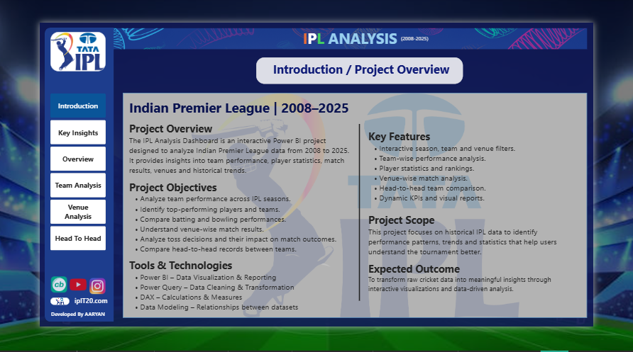
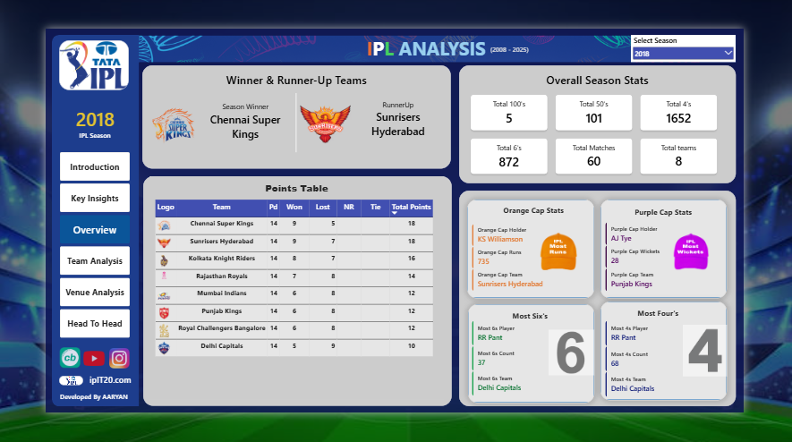

<h1 align="center">🏏 IPL Analysis Dashboard (2008–2025)</h1>

<p align="center">
  <b>An end-to-end Power BI project: from raw IPL data to a 6-page interactive dashboard with insights on teams, players, venues and rivalries.</b>
</p>

<p align="center">
  
  
  
  
</p>

<p align="center">
  <a href="https://github.com/aaryan-3360/IPL-Analysis-Power-BI-Dashboard/blob/main/docs/IPL_Analyisis_.pdf"><b>📄 View Dashboard PDF</b></a> &nbsp;•&nbsp;
  <a href="https://github.com/aaryan-3360/IPL-Analysis-Power-BI-Dashboard/blob/main/IPL_Analyisis_Dashboard.pbix"><b>📥 Download .pbix</b></a> &nbsp;•&nbsp;
  <a href="https://github.com/aaryan-3360/IPL-Analysis-Power-BI-Dashboard/blob/main/IPL%20Dataset/IPL%20Dataset.zip"><b>🗂️ Download Dataset</b></a>
</p>

---

## 🎯 Project at a Glance

| 18 | 1,169 | 14 | 38 |
|:---:|:---:|:---:|:---:|
| **Seasons** | **Matches** | **Teams** | **Venues** |

---

## 📌 Problem Statement

The IPL generates huge amounts of match and player data every season, but raw tables don't answer questions like *which team is the most consistent*, *which venues favour batting or bowling*, or *how rivalries have played out over time*.

This project turns **18 seasons of IPL data (2008–2025)** into an interactive dashboard that answers those questions in a few clicks.

---

## ❓ Business Questions Answered

- Which teams have been the most consistent across seasons?
- Who won the Orange Cap and who hit the most 4s and 6s in a season?
- How do venues differ in average score, bat-first vs bowl-first results and six-hitting?
- How have two teams performed against each other season by season?
- How has batting changed over time (sixes, fours, centuries, fifties)?

---

## 🖼️ Dashboard Preview

### 1. Introduction


### 2. Key Insights


### 3. Season Overview


### 4. Team Analysis


### 5. Venue Analysis


### 6. Head To Head


---

## 🔍 Key Insights

| # | Insight |
|---|---|
| 1 | **Batting has become far more explosive.** IPL 2023 alone saw **1,124 sixes and 2,175 fours** in 74 matches (about 15 sixes per match), and 2025 reached **1,296 sixes**, the highest of any season in the data. |
| 2 | **Star seasons decide tournaments.** Shubman Gill topped the 2023 Orange Cap with **890 runs** and also hit the most fours (**85**). |
| 3 | **Consistency wins over time.** CSK have a **56.35% win rate** (142 wins in 252 matches). |
| 4 | **Venues have personalities.** At Arun Jaitley Stadium, Delhi, bat-first and bowl-first wins are equal (**47 each**) with an average score of **165**, and sixes grew from **54 (2015) to 135 (2025)**. |
| 5 | **Most-used grounds:** M Chinnaswamy (99 matches), Arun Jaitley Stadium (97) and MA Chidambaram (91). |
| 6 | **Rivalries are lopsided.** In SRH vs KKR, KKR lead **26–13** across 39 matches. |

---

## 📄 Dashboard Pages

| Page | What it does |
|---|---|
| **Introduction** | Project overview, objectives, tools and navigation |
| **Key Insights** | All-time KPIs, overall summary, top venues, sixes by season |
| **Overview** | Season winner and runner-up, Orange/Purple Cap, most 4s and 6s, season slicer |
| **Team Analysis** | Matches, wins, losses, win %, points by season, team top scorer and wicket-taker |
| **Venue Analysis** | Result status, sixes by season, average score, top performers per venue |
| **Head To Head** | Team A vs Team B wins and season-wise points comparison |

---

## 🛠️ Skills Demonstrated

| Skill | How it was used |
|---|---|
| **Data Cleaning (Power Query)** | Cleaned and transformed the match and ball-by-ball data |
| **Data Modeling** | Built relationships between the match, team and player tables |
| **DAX** | Created measures for wins, win %, sixes, fours, caps and head-to-head |
| **Dashboard Design** | Consistent theme, sidebar navigation, slicers, KPI cards, area, bar and donut charts |
| **Storytelling** | Turned numbers into a Key Insights page and takeaways |

### Sample DAX (simplified)

```DAX
Win % =
DIVIDE([Total Won], [Total Matches Played])

Total Sixes =
CALCULATE(
    COUNTROWS(ball_by_ball_data),
    ball_by_ball_data[batsman_runs] = 6
)
```

---

## 📁 Repository Structure

```
IPL-Analysis-Power-BI-Dashboard/
├── README.md
├── IPL_Analiysis_Dashboard.pbix     # Power BI file
├── IPL Dataset/
│   └── IPL Dataset.zip              # Dataset (unzip before use)
├── docs/
│   └── IPL_Analiysis_.pdf           # Full dashboard as PDF
└── screenshots/                     # Page previews
```

---

## ▶️ How to Run

1. Clone or download this repository
2. Unzip `IPL Dataset/IPL Dataset.zip`
3. Open `IPL_Analiysis_Dashboard.pbix` in **Power BI Desktop**
4. If asked, update the data source path to the unzipped dataset folder
5. Use the sidebar to switch pages and the slicers to filter by season, team and venue

---

## 🚀 Future Improvements

- Add player-level analysis (strike rate, economy, consistency)
- Add toss-decision impact on match outcomes
- Add auction and salary data
- Publish to Power BI Service for a live shareable link

---

## ⚠️ Disclaimer

This project is for **educational and portfolio purposes only**. IPL, TATA IPL and team logos belong to their respective owners.

---

## 👨‍💻 About Me

**Aaryan Kamboj**, BCA graduate (CGPA 8.58/10) and Data Analytics intern, now building a career in **Data Analytics and Data Science**.

<p>
  <a href="https://www.linkedin.com/in/aaryan-kamboj123"></a>
  <a href="mailto:aaryankamboj520@gmail.com"></a>
  <a href="https://github.com/aaryan-3360"></a>
</p>

⭐ *If you found this project useful, please give it a star!*
